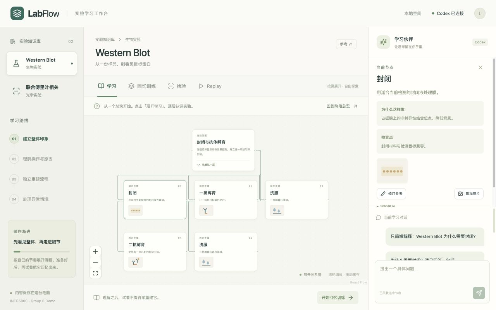

# LabFlow

把实验文档变成可逐层展开、主动回忆和实操重放的本地流程图。INFO5000 小组演示原型，优先支持笔记本电脑。



## 启动

需要 Node.js 22+、pnpm，以及本机已登录的 Codex。使用已有 ChatGPT/Codex 账号，不需要在网页输入 API key。

```sh
pnpm install
pnpm build
pnpm start
```

打开 <http://127.0.0.1:4317/>。Mac 完成安装和构建后，可双击 `start-demo.command`。开发时使用 `pnpm dev`。

网页和知识库在本地；请求 Codex 检查或聊天时，相关参考内容和本次作答会交给现有 Codex 服务。网络、账号或配额不可用时显示失败，保留草稿，不产生伪造评价。

## 五分钟演示

1. 在 Western Blot 总块点击「展开学习」，再展开「封闭与抗体孵育」。点节点查看操作、原因、检查点和来源。
2. 进入「回忆训练」。补全隐藏名称，提交检查；默认只显示正确、有错误或暂无法判断。
3. 按需请求宽泛提示、再具体一点、完整答案。二级提示只聚焦一处。帮助状态会跨同一参考版本的题型和换题保留。
4. 在顺序重建中从连接点连线。整段重建从空白开始，不预留标准数量的节点。配图可拖动，或先点图片再点目标流程块；一张卡可多次使用。
5. 进入 Replay，用上一步、下一步或下拉跳转辅助现场查看。记录个人笔记，或修订参考并保存新版本；图片可附在任何层级。
6. 切到联合傅里叶相关，演示同一机制复用于另一类实验。

切换训练层会恢复该层当前草稿。「换一题」另建题目；「收起帮助，开始新一轮独立回忆」才明确开启新的无资料尝试。两次不同题目的独立完成仅建议进阶，不代表长期保持或实验室操作能力。当前没有延迟测验或真正的掌握度估计。

## 范围

- WB 主例：五阶段概览，若干阶段逐层展开；当前训练重点为封闭与抗体孵育。
- JTC 辅例：光路调节与两次测量；当前训练重点为两次测量与判读。
- 支持图内文字、拖动、连线、删除与撤销、配图、异常情境文字作答。
- 学习/Replay 对话由真实 Codex 回答；回忆训练的帮助受渐进披露规则约束。
- 参考修订、个人笔记、附件、草稿与进度持久化到 `.labflow/`；不提供历史聊天/实验日志。
- 图片卡为示意图，不是原始实验照片。原始文档未上传到此仓库。
- 参考保留原文来源和未决条件。WB 丽春红染色表述冲突不作唯一标准答案；JTC 原文声明有误的图不用于训练。

## 接入已有 agent

`plugin/` 提供 Codex 本地插件包和教学 Skill，`server/mcp.ts` 暴露标准 MCP stdio 工具：读取上下文/参考、检查草稿/读取结果、请求提示、保存笔记、上传图片、提出参考修订。修订建议由网页确认应用。

安装到 harness 之前先启动网页服务。任意支持 MCP 的 harness 可使用：

```json
{
  "mcpServers": {
    "labflow": {
      "command": "node",
      "args": ["/absolute/path/to/labflow/plugin/server.mjs"]
    }
  }
}
```

把示例路径换为本机仓库的绝对路径。插件依赖当前 checkout 的依赖包，暂未制作独立发布包。插件文件已准备，是否安装/启用应以本机 Codex 插件设置为准。

MCP 使用 `.labflow/control-token` 的本机控制令牌，启动时轮换；它不是 GitHub token。服务仅监听回环地址，拒绝跨网站写请求。参考与内部诊断在本机服务端；这是一款自学工具，不是防作弊考试系统。

可选配置：`PORT`、`LABFLOW_DATA_DIR`、`CODEX_BIN`、`LABFLOW_MODEL`。默认模型取本机 Codex 返回的默认模型；不会修改全局模型设置。MCP 另支持 `LABFLOW_URL`、`LABFLOW_PROJECT_DIR`，测试实例需同时传递对应的数据目录。

## 验证

```sh
pnpm test
pnpm build
pnpm test:integration
pnpm check:codex  # 真实模型请求，消耗当前账号配额
```

集成检查使用临时本地目录，不改学习数据。人工/agent computer-use 结果见 `docs/testing.md`。
