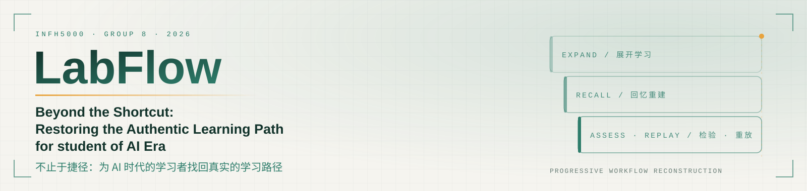
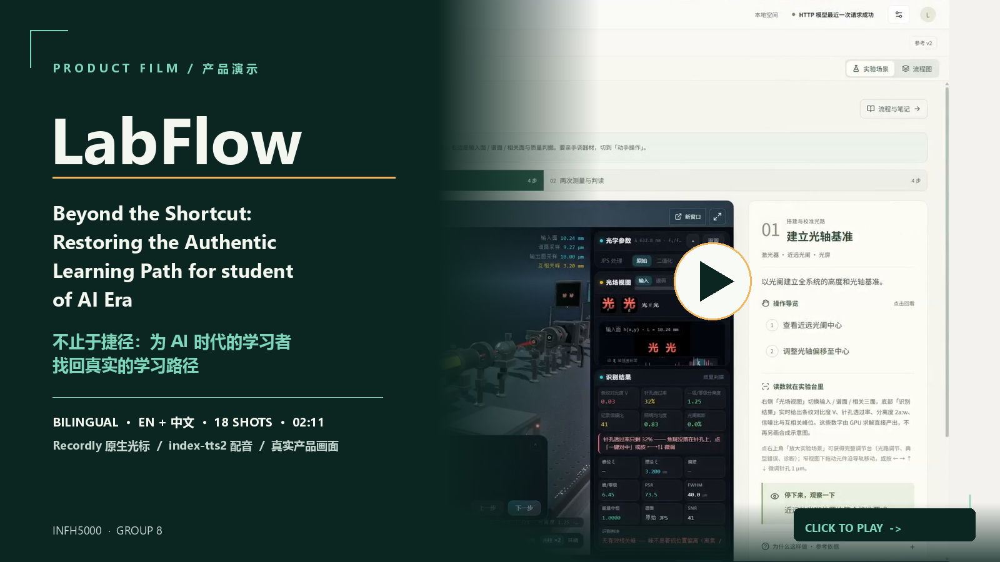
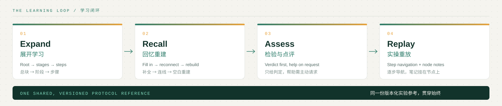

<div align="center">
  
</div>

<div align="center">

<b>Node.js 22+</b> &nbsp;·&nbsp; <b>pnpm</b> &nbsp;·&nbsp; <b>92 automated tests</b> &nbsp;·&nbsp; <b>Bilingual 中 / EN</b> &nbsp;·&nbsp; <b>Local-first 本地优先</b>

</div>

> **Beyond the Shortcut: Restoring the Authentic Learning Path for student of AI Era**
>
> **不止于捷径：为 AI 时代的学习者找回真实的学习路径**

| 中文 | English |
| --- | --- |
| 把一份实验文档，变成可逐层展开、主动回忆、按需求助、实操重放的**本地学习流程**。AI 随时可问，但回忆与推理始终由学习者完成。 | Turn a lab handout into a **local, layered workflow** of progressive study, active recall, help-on-request and stepwise Replay. AI is always available — but the learner keeps the recall and the reasoning. |

---

## ▸ 演示影片 / Watch the film

[](media/LabFlow-Product-Demo-EN-v2-Bilingual.mp4)

<div align="center">

<a href="media/LabFlow-Product-Demo-EN-v2-Bilingual.mp4">▶ 播放双语视频 / Play MP4</a> &nbsp;│&nbsp; <a href="media/LabFlow-Product-Demo-EN-v2-Bilingual.srt">下载外挂字幕 / SRT</a> &nbsp;│&nbsp; <a href="docs/showcase.html">完整版介绍页 / Full showcase（下载后本地打开）</a>

</div>

| ◆ 规格 / Spec | 值 / Value |
| --- | --- |
| 时长 / Runtime | **02:11** · 18 shots / 18 个镜头 |
| 字幕 / Subtitles | **EN + 中文** 双语两行，英文原文在上、中文在下 |
| 画面 / Footage | 100% 真实产品操作画面，Recordly 原生光标与自动缩放，无标题卡 / 无演示稿 |
| 配音 / Voice | index-tts2 · Linette English · 原速 untreated（`atempo = 1.0`） |
| 制作 / Production | Recordly 原生光标 + 自动缩放 · index-tts2 原速配音 ·  bilingual burn-in；[早期介绍片制作记录](docs/demo-video-production-2026-11.md) |

---

## ▸ 我们拒绝的捷径 / The shortcut we refuse

AI 让「得到答案」变得毫无成本。但**答案出现得太早，学习就结束了**。
AI makes answers free. When the answer arrives too early, learning stops.

| 常见捷径 / Shortcut | 代价 / What it costs | LabFlow 的选择 / Our choice |
| --- | --- | --- |
| 一次读完整个流程 / Read the whole protocol at once | 看起来懂了，其实只是认得字 / Recognition mistaken for recall | **渐进披露**：总块 → 阶段 → 步骤，展开才见细节 / Progressive disclosure |
| 直接问 AI 要步骤 / Ask AI for the steps | 该回忆的内容被直接给出 / The retrieval is done for you | **判定优先，帮助需请求**：只给对错，提示要一级级点开 / Verdict first, graduated help on request |
| 把提示切得极细 / Micro-hints at every turn | 推理路径被替你选好 / The reasoning path is pre-chosen | **宽泛 → 具体 → 答案**，另设详细点评 / Broad → specific → answer, plus detailed critique |
| 只看文字实验步骤 / Text-only procedure | 认得名称，认不得仪器 / Names without equipment | **三维实验台 + 观看演示 + 动手操作 + Replay** / 3D bench, demo, hands-on, Replay |

---

## ▸ 学习闭环 / The learning loop



| 阶段 / Stage | 中文 | English |
| --- | --- | --- |
| **01 Expand** | 从一个总块展开到阶段与步骤；每个节点给出操作、原因、检查点与来源 | One root becomes stages and steps; each node carries action, rationale, checkpoint and source |
| **02 Recall** | 细节补全 → 顺序重建 → 整段空白重建；草稿各自保留 | Detail fill → order reconstruction → blank-canvas rebuild, with separate drafts |
| **03 Assess** | 默认只给判定；宽泛提示、具体定位、答案与详细点评逐级请求 | Verdict only by default; broad hint, specific cause, answer and critique are requested, not pushed |
| **04 Replay** | 实验现场逐步导航，笔记与图片挂在当前节点；现场观察可回写参考 | Stepwise navigation at the bench, notes and images on the current node, observations feed reference revisions |

> **贯穿始终的是同一份版本化实验参考** — 旧题沿用旧版快照，判答结果绑定当次提交。
> **One shared, versioned protocol reference throughout** — old tasks keep their original snapshot and every verdict is tied to the submitted answer.

---

## ▸ 重点与优势 / What makes it different

| | 中文 | English |
| --- | --- | --- |
| ◆ | **帮助不接管学习**：求助会标记该回合为 assisted，直到学习者主动开启新的独立回合 | **Help never takes over**: a request marks the attempt assisted until a fresh independent round begins |
| ◆ | **两套案例，一个机制**：WB 考操作顺序与结果解读；JTC 把光轴调节接到 OPTILAB 的真实复数 FFT 求解 | **One design, two disciplines**: WB for order and interpretation; JTC for alignment with real Fourier optics |
| ◆ | **本地优先**：网页、知识库、笔记与个人数据都在本机；客观名称/别名、连线、配图优先本地判定 | **Local-first**: web app, reference, notes and drafts stay on the machine; deterministic checks run locally |
| ◆ | **AI 不可用也不假装**：受控超时保留作答并明确标注降级，不伪造模型评价 | **Honest degradation**: a timeout preserves the answer and labels the fallback instead of inventing a verdict |
| ◆ | **领域反馈变成界面决策**：转膜方向、封闭与一抗先后从「确认」改为「判断」，选错显示后果 | **Domain review becomes UI**: transfer orientation and blocking order became judgement tasks with visible consequences |
| ◆ | **可被外部 agent 接入**：MCP stdio 暴露上下文、检查、提示、笔记、图片与参考修订 | **Agent-ready**: an MCP interface exposes context, checks, hints, notes, images and reference revisions |

| **24** nodes / 节点 | **19** Replay steps / 步 | **7** scenario questions / 情境题 | **5** task types / 题型 | **92** tests passing / 测试通过 | **2** cases / 案例 | **4 / 5** user rating / 用户评分 |
| --- | --- | --- | --- | --- | --- | --- |

---

## ▸ 研究依据 / Evidence, not adjectives

报告不只描述功能，也记录了**哪里成立、哪里还没被验证**。
The report records what held up **and what has not been verified yet**.

| 已支持 / Supported | 尚未验证 / Not yet verified |
| --- | --- |
| 渐进披露 + 引导填空带来**真实回忆**：第一次需要 AI 解释每个概念的学习者，第二次无需重学即可回忆步骤顺序、仪器与操作 / Progressive disclosure and guided fill-in produced real recall on second use | **解释层最薄弱**：能排列与重建步骤，却说不清原理；检查器量的是措辞，不是理解 / Explanation remains the weak point; the checker measures wording, not understanding |
| 领域同伴走查把内容问题转成界面决策 / Domain walkthrough findings became interface decisions | **求助后是否回到独立练习**，本轮没有数据 / Whether learners return to independent work after an assisted round is untested |
| 详细点评补上了判定给不了的理由；同一答案由规则超时「不确定」变为 10.2s 判对 / Requested critique supplied the reasons a verdict could not | 空白重建被判为对首次学习者过早；图片附件与参考修订存在**可发现性**问题 / Blank reconstruction felt premature; some features were never discovered |

**完整双语摘要** → [`docs/report-summary.md`](docs/report-summary.md) &nbsp;│&nbsp; **原报告 PDF** → [`docs/LabFlow-report.pdf`](docs/LabFlow-report.pdf)

---

## ▸ 快速开始 / Quick start

需要 Node.js 22+ 与 pnpm。图形操作、Replay 与可确定的客观题检查**无需 AI 登录**；聊天、主观判答与 AI 出题可接入自己的 Codex，或显式配置 HTTP 模型服务。
Node.js 22+ and pnpm. Scene interaction, Replay and deterministic checks need **no AI sign-in**; chat, subjective judgement and generated questions use a configured backend.

```sh
pnpm install
pnpm build
pnpm start
```

打开 <http://127.0.0.1:4317/>。开发时用 `pnpm dev`；Mac 完成安装与构建后可双击 `start-demo.command`。
Open <http://127.0.0.1:4317/>; use `pnpm dev` for development.

```sh
pnpm test
pnpm test:integration
pnpm check:codex   # 真实模型请求，消耗当前账号配额 / real model call
```

发给队友试用：`pnpm package:share` 生成 `releases/LabFlow-0.3.0-team.zip`，队友只需 Node.js 22+，不需要安装依赖或构建。分享包**不含** `.labflow`、凭据或个人笔记，请转发原始 ZIP。
For teammates: `pnpm package:share` builds a dependency-free ZIP. It excludes `.labflow`, credentials and personal notes — forward the original ZIP.

---

## ▸ 工程说明 / Engineering notes

- **AI 后端 / Backends**：`Codex` 本地插件，或 `LABFLOW_AI_BACKEND=openai-compatible` + `LABFLOW_API_BASE_URL` / `LABFLOW_MODEL`；支持 Chat Completions 与 Responses，详见 [接入说明](docs/ai-backends.md)。密钥只从本机环境变量读取，不写入网页或分享包。
- **MCP / Agent harness**：`plugin/` 提供本地插件包，`server/mcp.ts` 暴露标准 MCP stdio 工具；启动时轮换 `.labflow/control-token`，服务只监听回环地址并拒绝跨站写请求。安装到 harness 前请先启动网页服务。
- **数据 / Data**：参考修订、笔记、附件、草稿与进度持久化到 `.labflow/`；升级沿用原目录，首次升级会保存 `state.before-v0.2.json`。这是一款自学工具，不是防作弊考试系统。
- **模型设置 / Model settings**：网页右上角选择模型，保存到 `.labflow/agent-settings.json`；不会修改全局模型设置。AI 不可用时保留本地「有错误 / 暂无法判断」并标注规则来源。

<details>
<summary><b>范围与边界 / Scope &amp; limits</b></summary>

- WB 主例：六阶段、24 节点、19 步 Replay、7 道情境题；JTC 辅例保留原异常题。
- JTC 演示模式由内嵌 OPTILAB 提供真实求解；动手模式仍是教学示意台。场景与二维读出是教学合成示意，不计入独立完成次数。
- 图片卡为示意图，不是原始实验照片；原始文档未上传到此仓库。
- 没有延迟测验，也没有真正的掌握度估计；生成内容仍需人工审阅。
- 无实体实验场景使用记录；模拟保真度有限，不校验脱离脚本的操作。

</details>

---

## ▸ 文档地图 / Documentation

| 主题 / Topic | 链接 / Link |
| --- | --- |
| 双语报告摘要 / Bilingual report summary | [docs/report-summary.md](docs/report-summary.md) |
| 完整版介绍页 / Full showcase page | [docs/showcase.html](docs/showcase.html) |
| 早期介绍片制作记录 / Earlier production notes | [docs/demo-video-production-2026-11.md](docs/demo-video-production-2026-11.md) |
| 交互实验场景 / Interactive lab scenes | [docs/interactive-lab-scenes.md](docs/interactive-lab-scenes.md) |
| OPTILAB 接入 / OPTILAB integration | [docs/optilab-integration.md](docs/optilab-integration.md) |
| AI 后端 / AI backends | [docs/ai-backends.md](docs/ai-backends.md) |
| 人工测试 / Manual testing | [docs/manual-testing-0.3.0.md](docs/manual-testing-0.3.0.md) · [docs/testing.md](docs/testing.md) |

---

<div align="center">

<b>INFH5000 · Group 8</b> &nbsp;│&nbsp; Qihuan ZENG · Yunhan CHEN · Xuanling LUO · Zixin XU &nbsp;│&nbsp; 各 25% / 25% each

<sub>Progressive Workflow Reconstruction with On-Demand AI Guidance for Laboratory Preparation</sub>

</div>
