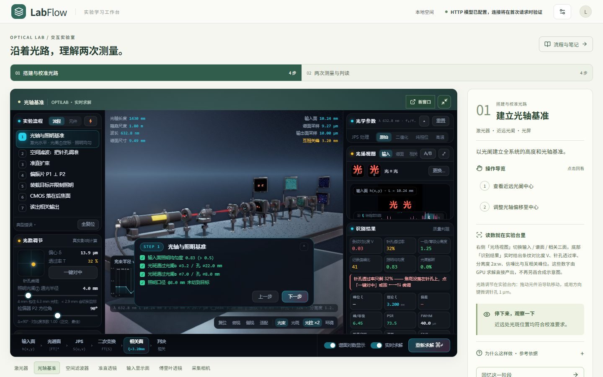

# JTC 实验台接入 OPTILAB

> 位置：`public/optilab/`（原样内置，不改动仿真代码）
> 桥接层：`src/lab/optilab-bridge.ts`、`src/lab/OptilabStage.tsx`
> 上游仓库：<https://github.com/Tewhac-China/optilab>



## 两层实验台

JTC 案例的「观看演示 / 动手操作」两种模式现在对应两种实验台：

| 模式 | 实验台 | 用途 |
|---|---|---|
| 观看演示（默认） | OPTILAB 子应用 | 真求解：联合功率谱、相关峰、条纹对比度都是算出来的 |
| 动手操作 | `LabScene` 光学分支 + `HandsOnPanel` | 快速上手：激光开关、X-Y 偏移、采集快照，步子轻 |

动手这一层保留 `17e8314` 引入的 `handsOn.optics` 状态机（`HandsOnPanel` 与它绑定），
所以只在「观看演示」时切到 OPTILAB；切模式不会丢实验状态。

## 为什么要有真求解那一层

0.3.0 起的 JTC 三维场景是程序化几何的**教学示意**：元件位置、光斑和「相关峰」
都由动画状态驱动，不做任何傅里叶计算，右侧「输入面 / 采集结果」两张图是写死的
SVG。学生调错参数时，除了颜色变化，拿不到任何可信的读数。

OPTILAB 是同一门课的独立仿真工程，做的正是这件事的真版本：

- GPU 复数二维 FFT（1024²，RGBA32F），谱面 `S=|FT{h}|²`、输出面 `FT{S}` 逐像素求解；
- 针孔偏心 δ → 透过率 `exp(−2δ²/w₀²)`、光阑截断、偏振夹角、CMOS 离焦都**真的**
  进入计算链，不是贴图；
- 输出条纹对比度 V、峰位 ξ、峰/零级比、PSR、信噪比，可当场判读。

所以演示模式改为把 OPTILAB 作为子应用嵌进实验台，LabFlow 只负责流程、笔记、
回忆训练与参考修订——分工与原来一致，只是换了真正的求解器。

## 接入方式

```
public/optilab/
├── index.html   ← 加了一行 embed.css、一行 embed.js
├── css/         app.css（原样）+ embed.css（内嵌模式）
└── js/          app.js 等 11 个原文件 + embed.js（消息桥）
```

内嵌模式由 `?embed=1` 触发，独立打开 `index.html` 时 `embed.js` 直接 return，
一行都不执行，行为与上游完全一致。

- **顶栏让给宿主**：`#topbar` 隐藏，腾出 54 px；
- **按容器宽度自适应**：≤1180 px 收窄三栏，≤940 px 收起左栏（画布优先），
  ≤620 px 只留画布；
- **引导卡默认折叠**：宿主的右栏已经在讲这一步，正文会挡住光路；
- **步骤只走 postMessage**：`set-step / set-mode / set-view / solve / reset-view`，
  子页回报 `ready / step / error`。

## 步骤映射（人工核对，不做模糊匹配）

LabFlow 的 JTC 有 8 步，OPTILAB 引导流程有 7 步，两边不是一一对应：

| LabFlow | 步骤 | OPTILAB |
|---|---|---|
| `jtc-axis` | 建立光轴基准 | 0 光轴与照明基准 |
| `jtc-coaxial` | 元件等高共轴 | 0（同上，调的是同一件事） |
| `jtc-filter` | 空间滤波 | 1 空间滤波：把针孔调准 |
| `jtc-collimate` | 准直扩束 | 2 准直扩束 |
| `jtc-input` | 装载双目标 | 4 装载目标并限制照明 |
| `jtc-spectrum` | 第一次测量：记录 JPS | 5 CMOS 落在后焦面 |
| `jtc-reload` | 换入功率谱 | 5（子应用里由「二次变换」接管） |
| `jtc-read` | 第二次测量：读相关峰 | 6 读出相关输出 |

OPTILAB 的第 3 步「偏振片 P1⊥P2」在 LabFlow 的流程里没有独立节点，因此只会
在子应用内部被访问到，不参与向上同步。

## 双向同步的两个坑

1. **iframe 的 `src` 不能跟着 step 变**。第一版把 `src` 写成 `embedUrl(index)`，
   每换一步浏览器就重新载入整个子应用：GPU 上下文重建、首次求解重跑、学生刚调
   好的针孔全部丢失。现在 `src` 只在挂载时算一次，之后只发消息。
2. **必须吞掉回声**。子页上报「我现在在第 N 步」后，宿主映射回 LabFlow 步骤、
   又下发 `set-step N`，子页再上报……不记录「自己刚下发的那一步」就会来回顶。
   `OptilabStage` 用 `posted` ref 过滤这类回声。

## 视觉与可用性边界

- 默认实验台宽度约 740 px，OPTILAB 会收起左栏，只留画布 + 光场/判据栏。
  点「放大实验场景」后宽度 1066 px，完整三栏可用（光路调节、典型错误、诊断）。
- 「动手操作」仍是示意台：它的作用是把器材位置和操作顺序先走一遍，读数不可引用；
  要判据请回「观看演示」。
- 暗色 3D 场景嵌在浅色 LabFlow 里是有意的：这是光学平台，不是示意图。
- 子应用自带播放与引导，LabFlow 的「演示控制 / 逐项回看」在 JTC 下隐藏，
  避免出现两套互相打架的播放按钮。
- 窄视图下针孔仍可用方向键微调（1 µm，Shift 5 µm），需要指针交互时请放大。

## 如何更新 OPTILAB

```bash
# 在上游仓库改完后同步进来（只覆盖仿真本体，保留 embed.css / embed.js 的修改）
rsync -a --delete <optilab>/index.html <optilab>/css <optilab>/js public/optilab/
```

`public/optilab/` 是快照，不做 submodule：这样 `pnpm build` 不依赖网络，
打包分享时也不需要额外的 git 操作。
