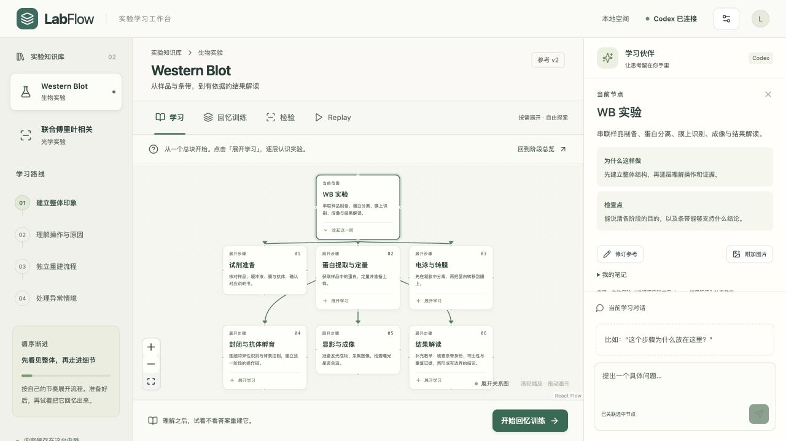

# LabFlow 0.2.0 界面验收

2026 年 10 月 16 日，对提交 `f03d1c36520424fa7a9fea043fbc958592dfd04c` 进行实际界面验收。核心判题、编辑恢复、模型选择和新增内容可用，但流程连线、具体提示与上下文聊天仍有缺口，不宜把全部 issue 标为完成。

## 执行范围

三个独立评审 agent 分别使用 gpt-6-sol / high、gpt-6-astra / xhigh、gpt-6-luna / high，负责交互、教学、离线与模型设置。它们的 IAB 入口不可用，原生 Edge 连接也未返回可操作状态，因此**没有完成子 agent 亲自操作浏览器的验收**。后续由主 agent 按评审场景使用 CUA 实际操作，三个 agent 独立查看截图与操作记录。以下通过项按这一执行方式理解。

本轮使用 1280×720 浏览器视口及三个隔离实例：4331 交互与模型选择、4332 真实 Codex 教学请求、4333 指向不存在的 Codex 可执行文件以模拟模型不可用。后者没有退出用户账号，所以证明的是模型不可用回退，不是完整的未登录流程。测试数据不写入正式学习目录。

## Issue 结论

| Issue | 结论 | 实际覆盖 |
| --- | --- | --- |
| [#2 可读性](https://github.com/RogersIV144/labflow/issues/2) | 部分通过 | 主按钮、当前任务和选中态可识别；练习画布很矮，配图模式缩放后的卡片文字过小。完整 WCAG AA 未验收。 |
| [#3 流程布局](https://github.com/RogersIV144/labflow/issues/3) | 未修到位 | 根节点通往第二排的连线被第一排卡片遮挡，容易被读成错误的阶段关系；Fit View 后仍存在。连接点选择也有显示不一致。 |
| [#4 模型选择](https://github.com/RogersIV144/labflow/issues/4) | 核心通过 | 在 UI 选择并保存 gpt-6-luna，停止并重启隔离服务，刷新后所选与当前模型仍为 gpt-6-luna。离线时“自定义 HTTP 模型”标签易误导。 |
| [#5 主观点评](https://github.com/RogersIV144/labflow/issues/5) | 已覆盖路径通过 | 两道错误主观答案默认只显示“有错误”；显式点评后才显示原句、错误、遗漏、修订和依据，并标记受助。绿色正确片段未覆盖。 |
| [#6 动态训练](https://github.com/RogersIV144/labflow/issues/6) | 部分通过 | AI 掩码选择成功且掩码发生变化；AI 情境生成本次回退，状态明确。具体提示仍泛泛，具体问题的聊天回复仍呈固定宽泛提示。 |
| [#7 HTTP 接入](https://github.com/RogersIV144/labflow/issues/7) | 实际服务待验收 | 本轮没有真实 CC Switch 地址和凭据，不能确认代理兼容性。现有配置文档与 Codex 不可用提示可读，不等于 HTTP 联调成功。 |
| [#8 无模型回退](https://github.com/RogersIV144/labflow/issues/8) | 已覆盖路径通过 | 空白判错、精确名称判对、未知同义表达与主观题均显示无法判断，来源明确为规则检查。 |
| [#9 多阶段多题](https://github.com/RogersIV144/labflow/issues/9) | 核心通过 | 阶段切换、旧图稿恢复、无配图时回到细节补全均通过；异常题下拉有七类，实际切换了结果解读、封闭液、膜预处理、步骤因果。 |
| [#10 内容补充](https://github.com/RogersIV144/labflow/issues/10) | 内容入口通过 | Replay 有 19 步，可进入膜预处理与五个结果解读节点；来源明确标为非课程原文的补充教学。 |
| [#11 六道新题](https://github.com/RogersIV144/labflow/issues/11) | 题库与抽样通过 | 七题菜单可见，结果解读和封闭液题实际提交检查；BSA 点评保留条件差异。其余题未逐题评分。 |

## 需要继续修复的行为

### 阶段总览连线误导

从 WB 根块展开六个阶段。实际关系都是 WB 到子阶段，但通往第二排的曲线穿过第一排卡片，视觉上像“试剂准备→封闭”“蛋白提取→显影”“电泳转膜→结果解读”。手动适配画布后仍然如此。这直接影响学习者对关系的理解，建议优先修复。

### 第二级提示没有定位实际问题

结果解读题提交：“处理组更亮，所以目标蛋白一定上调，而且证明了转录上调。我们把同一样品连续曝光三次，就已有三个生物学重复，不需要内参或总蛋白归一化。”

检查只给“有错误”，宽泛提示给出亮度与生物学量的区分，这两步符合要求。再点“再具体一点”后却仍只说：“先检查你的结论是否有题目中的证据支持，以及有没有把一种可能原因当成唯一原因。再回看你写出的理由。”没有定位原句或解释一处原因。完整答案只有显式请求后才出现，因此问题是帮助不足，不是自动泄题。`server/engine.ts` 的异常题第二级提示目前确实是通用文本。

[具体提示截图](qa-2026-10-16/labflow-qa-1016-teaching-specific.jpg)

### 上下文聊天仍回到宽泛模板

在封闭液题中提问：“我这里把封闭液和一抗稀释液看成同一件事，这两个用途有必要分开核对吗？请只解释概念，不给本题完整答案。”

回复为：“先区分‘某类抗体的一般经验’和‘这支抗体已经验证的条件’；同一种试剂在不同用途下是否必然适用？”与该题的宽泛提示相同。它没有解释两个用途，也未说明当前帮助等级的限制。未泄露完整答案，但不足以证明具体疑问已得到上下文解答。

[聊天截图](qa-2026-10-16/labflow-qa-1016-teaching-chat.jpg)

### 连接点和小画布仍影响操作

从封闭卡右侧连接点拖至一抗卡左侧后，创建连线成功，但曲线显示为卡片下方到目标上方。删除、撤销、刷新及跨阶段恢复均保留同一条逻辑边。`AnswerEdge` 和答案序列化仅保存节点端点，不保存连接点；左右 Handle 也没有显式 ID，需一并检查。

1280×720 下，配图工具栏、题型与答案区占据较多高度，图卡被缩得很小。截图支持“阅读与操作空间不足”，不据此断言所有场景都会裁剪。

[连接恢复](qa-2026-10-16/labflow-qa-1016-order-restored.jpg) · [配图界面](qa-2026-10-16/labflow-qa-1016-images-attached.jpg)

## 通过项的具体证据

- **离线规则检查**：WB 总阶段两个名称为空时判错；填入“试剂准备”“蛋白提取与定量”后判对，显示 1/2 次独立完成；把后者换成“提取样品蛋白并测量浓度”后显示“无法判断／语义评价尚未完成”。主观题非空答案也未伪判正确。[精确答案](qa-2026-10-16/labflow-qa-1016-offline-correct.jpg) · [未知措辞](qa-2026-10-16/labflow-qa-1016-offline-uncertain.jpg)
- **显式详细点评**：BSA 题两句绝对化答案均被准确引用并以红色删线标示，遗漏单独显示，修订建议和 Abcam/CST 补充来源可见，明确反对“一律用 BSA／换了就一定解决”。[点评上部](qa-2026-10-16/labflow-qa-1016-teaching-review.jpg) · [遗漏与来源](qa-2026-10-16/labflow-qa-1016-teaching-review-more.jpg)
- **模型持久化**：UI 保存 gpt-6-luna 后，实际重启同一隔离服务并刷新页面，当前模型仍为 gpt-6-luna。[重启后模型](qa-2026-10-16/labflow-qa-1016-model-restarted.jpg)
- **多阶段与编辑恢复**：拖动封闭卡，创建封闭到一抗的边，删除、撤销、立即刷新、切换结果解读再返回，均恢复原边。切到没有图片的阶段时，显示说明并自动切回细节补全。
- **图片归位**：先选图再点击流程块后出现“节点附件 1／移除附件”。原生拖放本次只选中了图片，没有附加成功；尚不能区分应用缺陷与 CUA 手势限制。
- **AI 掩码与情境回退**：结果解读原本遮住第 1、2 步，AI 出题后改为第 2、3 步并显示 AI 来源；情境生成本次明确回退预置题，不计成功生成。[AI 掩码](qa-2026-10-16/labflow-qa-1016-ai-mask.jpg) · [情境回退](qa-2026-10-16/labflow-qa-1016-ai-scenario-fallback.jpg)
- **补充内容**：Replay 第 7 步区分普通干燥 PVDF、NC 与特殊产品要求；第 15–19 步包含身份、线性、归一化、生物重复与结论边界，最后一步禁用“下一步”。[Replay 末步](qa-2026-10-16/labflow-qa-1016-root-replay.jpg)。七类选项为背景与曝光、结果解读、封闭液选择、膜预处理、大蛋白转膜、步骤因果、系统排查；见[实际界面的可访问性记录](qa-2026-10-16/question-options.txt)。浏览器截图没有捕获原生弹出菜单，因此不以关闭状态的截图证明选项数量。

本轮未进行 Windows/Linux 真机测试、实际 CC Switch 联调、完整无登录流程或完整 WCAG 审计。没有把此前自动测试的通过记录算作本轮子 agent 的电脑操作证据。
