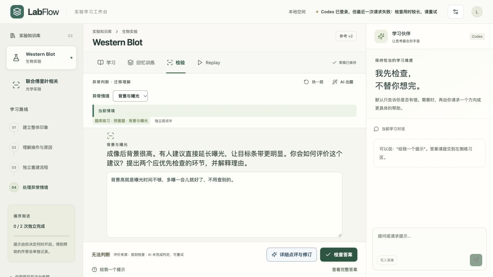

# 2026-10-29 · WB 教学与 AI 降级合并复测

## 版本与范围

- 拉取时主分支为 `4170195`。
- WB 分支 `feat/wb-lab-teaching`：`d710bbb`、`04d0b51`，转膜选边、免疫检测首步判断、曝光饱和提示、内参条带。
- AI 分支 `fix/ai-degrade-fast`：`05a000d`，判题与聊天时限、失败状态及降级标记。
- 两个分支分别验证后合入主分支，保留原作者提交。合并复核补齐前端状态刷新、公开降级提示、HTTP 请求时限与失败恢复，以及 Codex 在 turn 启动前失败的状态记录。
- Mac 本机独立数据目录；测试没有使用或改写日常学习记录。浏览器操作由主 agent 完成。

## 自动与集成验证

- WB 分支：88 项测试通过，类型检查和生产构建通过。
- AI 分支：86 项测试通过，类型检查和生产构建通过。
- 合并及补修后：92 项测试通过；类型检查、生产构建、HTTP/MCP 集成检查通过。
- 新增回归覆盖：超时后标记降级、成功重试恢复、主动取消不标记服务故障、thread 创建失败、HTTP 请求级时限、未完成判定不泄露诊断且不计独立完成。
- 构建仍有 Three.js 场景分包大于 500 kB 的体积提示；本次未调整加载策略。

## WB 浏览器实操

在 Edge 中，从新吸头、吸液、向泳道加样、合盖和电泳开始，逐步完成以下检查：

| 操作 | 观察 |
| --- | --- |
| 不选择膜侧直接转膜 | 被阻止，要求先判断膜侧 |
| 选择阴极侧再转膜 | 被阻止，膜层变红，显示原因 |
| 改选阳极侧并转膜 | 可以完成 |
| 选择先上一抗 | 显示原因；完成免疫检测操作仍被阻止 |
| 改选先封闭 | 可以完成免疫检测并进入成像 |
| 采集中等曝光 | 显示合成条带和下方内参，空泳道保持空白 |
| 曝光调到 100 并重新采集 | 出现饱和信号及“不能用于定量比较”提示 |

这些判断发生在学习场景的动手模式；回忆练习保持默认只判对错、按需逐级提示。

## 真实 Codex 检查

使用 `gpt-6.1-sol`、low 推理强度，经真实本机 Codex app-server 调用。沿用体验材料中的文本，将连续步骤连成有向链。耗时从提交检查到获得结束状态，以 400 ms 间隔查询；它衡量服务响应，不是学习者作答时间。

| 输入 | 合并版耗时 | 结果 |
| --- | --- | --- |
| 抗体阶段原名：封闭→一抗孵育→洗膜→二抗孵育→洗膜 | 0.41 s | 正确，规则检查 |
| 同阶段自己的表述：封闭液封闭→加一抗→洗膜→加二抗→洗膜 | 10.24 s | 正确，Codex |
| 结果解读自己的表述 | 8.17 s | 正确，Codex |
| 背景高就延长曝光、不检查其他环节 | 9.00 s | 有错误，Codex |

逐项输入与结果见 [live-checks.json](qa-2026-10-29/live-checks.json)。本机本轮未复现原体验材料中的 120 秒超时；版本和运行环境均有变化，不能把响应时间差异单独归因于超时参数修改。

## 受控超时的界面复核

另用合成 app-server fixture 和 100 ms 判题时限稳定触发超时；fixture 仅用于验证故障处理，不用于上表真实判题。

- 原 AI 分支：接口已经返回 degraded，但网页仍显示“Codex 已连接”，作答区仅显示原有“语义评价尚未完成”。
- 补修后：顶部自动显示最近一次请求失败；作答区显示“AI 未完成判定，可重试”；答案保留，独立完成仍为 0/2。
- 成功重试清除降级与取消不损害健康状态另由自动回归验证。

## 尚待学习者验证

新手首次学习、隔日重建和真实实验期间 Replay 的体验仍需对应参与者记录。此文件记录软件行为，不增加报告的参与人数。
